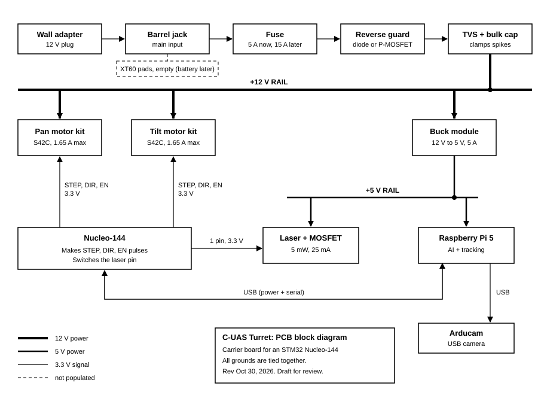

# PCB block diagram and parts directory

Last updated: Oct 30, 2026

Line weights: thick = 12 V power, medium = 5 V power, thin = 3.3 V signal,
dashed = not populated. All grounds are tied together.

The diagram shows the carrier PCB, the Raspberry Pi 5, the Arducam and the
two S42C motor kits. Decisions behind it are in `design-decisions.md`.

## Parts directory

| Part | What it does | Why I use it |
|---|---|---|
| Wall adapter (12 V) | Plug-in 12 V power | I want one simple plug, like a USB charger, not a battery. |
| Barrel jack | Socket the adapter plugs into | It matches my wall plug. XT60 pads stay empty for a battery later. |
| Fuse (5 A now, 15 A later) | A metal strip that melts if the current gets too high | A short cannot overheat my wires or start a fire. |
| Reverse guard (diode or P-MOSFET) | Blocks current if + and - are swapped | I saw reversed rails on the bench while testing laser modules. This keeps a backwards supply from killing the board, so I don't repeat the same mistake. |
| TVS + bulk capacitor | The TVS shorts voltage spikes to ground. The capacitor is a small charge tank. | Motors and cables make spikes that could damage the buck module or the motor drivers. |
| 12 V rail | Shared, protected power line | One clean source for the motors and the buck module. |
| S42C motor kits (2) | Closed-loop stepper with a built-in driver and position sensor | Closed-loop fixes backlash and lost steps. I only send STEP, DIR and EN. |
| Buck module | Efficiently steps 12 V down to 5 V | The Pi and laser need 5 V. A linear regulator would burn about 21 W as heat. |
| 5 V rail | Shared 5 V line | Feeds the Pi and the laser. |
| Raspberry Pi 5 (8 GB) | Runs my trained model and tracking. Powers the camera and the Nucleo over USB. | It is the vision brain. USB means one cable for power and serial. |
| Arducam USB camera | Sees the target | I train and run on the same camera. |
| Nucleo-144 | Makes exact STEP, DIR and EN pulses and switches the laser | The Pi could do it, but its timing wobbles when the AI is busy. The Nucleo stays steady. |
| Laser + MOSFET | 5 mW red dot. The MOSFET is a switch a Nucleo pin can drive. | The dot is my lock-on indicator. A Nucleo pin is too weak to power it directly. |

## Open items on this diagram

- Reverse guard: diode or P-MOSFET (decided in the calculations step).
- 5 V module: Pololu D24V50F5 is the lean. See Decision 5.
- Pi 5 USB power limit: the Pi may cap its USB ports at about 600 mA unless
  told its supply is strong (`usb_max_current_enable=1` in `config.txt`).
  The camera plus the Nucleo may be near that. Verify on the real Pi.
